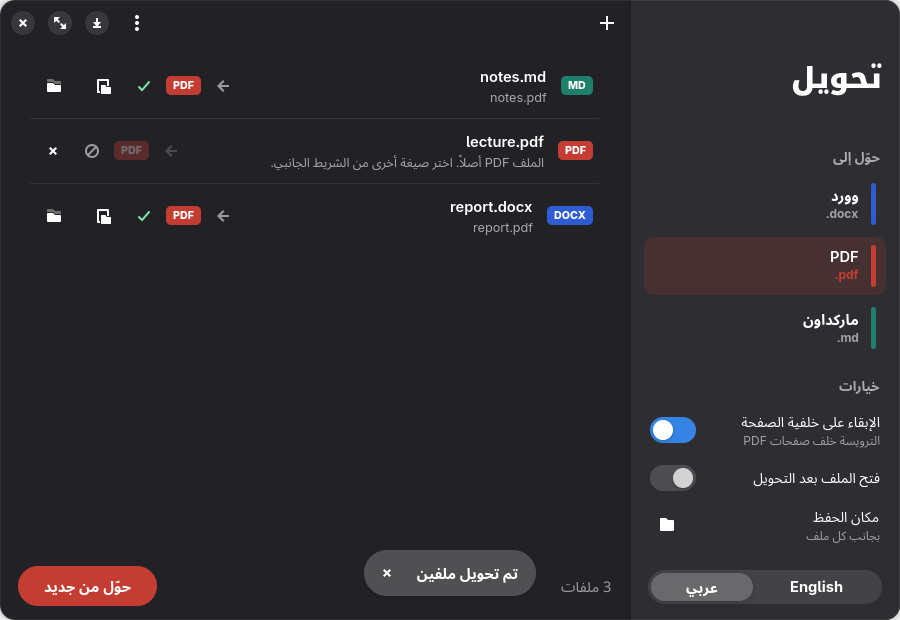
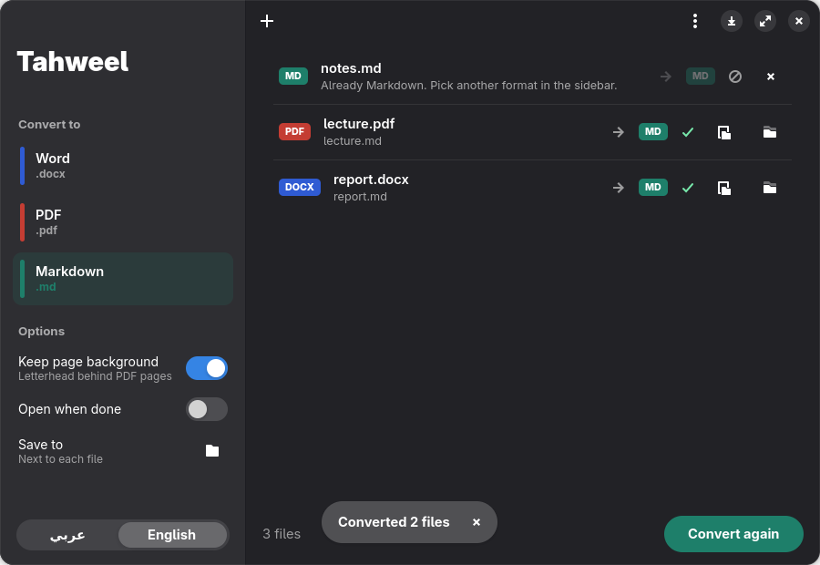

# Tahweel · تحويل

Convert between **PDF**, **Word (.docx)** and **Markdown**, in any direction, with Hebrew, Arabic,
English (or a mix) kept in the right order.

| from \ to | Word | PDF | Markdown |
|---|---|---|---|
| **PDF** | rebuilt as editable paragraphs (below) | — | headings, lists, code, images |
| **Word** | — | printed by LibreOffice (exact layout) | headings, real Word numbering, tables, links, images |
| **Markdown** | headings, lists, quotes, code, tables, links | via Word, printed by LibreOffice | — |

Default target when you don't pick one: PDF → Word, Word → PDF, Markdown → Word.

<p align="center">
  
  
</p>

### PDF → Word

Generic converters (LibreOffice, `pdf2docx`) either scramble right-to-left text or put every line in its
own frame. Tahweel rebuilds the document instead:

- **Reading order**: glyphs are re-ordered from their visual positions back to logical order, with
  Latin words and numbers inside RTL text handled correctly (stream order breaks the ambiguous cases).
- **Structure**: lines are joined into paragraphs; numbered/lettered items (`1.`, `א-`, `•`) become
  hanging-indent items; centred titles, indents and spacing are kept.
- **Formatting**: fonts, sizes, bold/italic, colours, underlines (drawn as thin rules in the PDF) and
  shaded backgrounds.
- **Code blocks**: monospace lines keep their indentation and syntax colours.
- **Letterhead**: a full-page background image (logo + footer) is placed behind every page.
- **Page numbers** become a real PAGE field; repeated header/footer text goes to the header/footer.

### Markdown

- Read with CommonMark rules plus GFM tables and `~~strikethrough~~`. Each paragraph's direction comes
  from its first strong letter (like `dir="auto"`), so Hebrew/Arabic paragraphs come out right-to-left in
  Word and PDF, and tables with mostly RTL text are mirrored.
- Written as plain CommonMark/GFM. Images are saved to a `<name>-images/` folder next to the `.md`.
  Fonts, colours and sizes have no Markdown form and are dropped; from a PDF, larger lines become `#`/`##`.
  Lists labelled with Hebrew/Arabic letters (`א-`, `ب.`) stay as text, since Markdown lists are only `-` and `1.`.

## Install

```sh
./install.sh      # creates .venv here, adds ~/.local/bin/tahweel + app-menu entry
./uninstall.sh    # removes the launcher, menu entry and icon (project folder stays)
```

Command line only (no app-menu entry): `pip install .` gives you the `tahweel` command.

Needs Python 3.11+, GTK 4 + libadwaita Python bindings (`python-gobject`, `libadwaita`) for the window,
and LibreOffice (`soffice`) for PDF output. LibreOffice runs headless with its own profile in
`~/.cache/tahweel/lo-profile`, so an open LibreOffice window doesn't interfere.
The installer does not change your default apps; Tahweel just appears under "Open With" for PDF, Word and
Markdown files.

## Use

**Window**: run `tahweel` (or open "Tahweel / تحويل" from the app menu). Drop files or folders onto it,
pick the target under **Convert to** (Word, PDF or Markdown), then press **Convert**. Files already in
that format are skipped. Every file gets Open / Show in Folder buttons when it finishes.
`Ctrl+O` adds files, `Ctrl+Enter` converts, `Ctrl+L` clears the list.
The first launch asks for the interface language (Arabic or English); the switch at the bottom of the
sidebar changes it at any time without losing the file list. The choice is saved in
`~/.config/tahweel/settings.json` (`TAHWEEL_LANG=en tahweel` forces one for a single run).

**Terminal**:

```sh
tahweel homework.pdf                 # writes homework.docx next to it ("homework (1).docx" if it exists)
tahweel homework.pdf -t md           # PDF → Markdown
tahweel notes.md -t pdf              # Markdown → PDF
tahweel report.docx                  # Word → PDF (the default for Word)
tahweel report.docx -o report.md     # the output name picks the format
tahweel a.pdf b.pdf -o ~/Documents/  # several files into a folder
tahweel scan.pdf -o out.docx --force # pick the name, overwrite
tahweel file.pdf --no-background     # drop the letterhead image
tahweel file.pdf --open              # open the result when done
```

**Python**:

```python
import tahweel
doc = tahweel.convert("in.pdf", "out.docx")       # format from the extension; returns the parsed Document
tahweel.convert("notes.md", "notes.pdf")
doc = tahweel.read("report.docx")                 # any input -> tahweel.model.Document
tahweel.write(doc, "report.md")                   # Document -> docx / md / pdf
```

To write a document by hand (no PDF), build `tahweel.model` objects and call `tahweel.writer.write_docx`;
`examples/build_document.py` is a complete example (Arabic, Hebrew and English, a list, a table and code).

## Layout

| Path | What |
|---|---|
| `tahweel/__init__.py` | `convert`, `read`, `write`, format detection and output names |
| `tahweel/extract.py` | PDF → `Document`: glyphs → lines → paragraphs, lists, code, images, header/footer |
| `tahweel/docx_reader.py` | Word → `Document`: styles → headings/quotes/code, numbering → list labels, tables |
| `tahweel/markdown_io.py` | Markdown ⇄ `Document` |
| `tahweel/office.py` | Word → PDF through headless LibreOffice |
| `tahweel/bidi.py` | visual → logical order for RTL/LTR lines |
| `tahweel/model.py` | the intermediate model (`Document`, `Paragraph`, `Run`, `Image`, `Table`, `Rule`, `PageBreak`) |
| `tahweel/writer.py` | `Document` → `.docx` (RTL markup, schema-ordered XML, background anchor) |
| `tahweel/cli.py`, `tahweel/app.py` | command line and GTK window |
| `tests/` | unit tests, docx → PDF → docx and md → docx → md round trips, `dump.py` to inspect extraction |

```sh
PYTHONPATH=. .venv/bin/python -m unittest discover -s tests   # round trip needs LibreOffice
PYTHONPATH=. .venv/bin/python tests/dump.py file.pdf          # see what the extractor found
```

## Limits

- **Math** (equations, matrices, fractions) comes out as loose characters: PDFs keep only positioned
  glyphs, not the formula structure.
- **Tables in PDFs** become plain paragraphs (tables in Word and Markdown files convert fine); multi-column layouts are read column-by-column only when the
  columns are far apart.
- **Scanned PDFs** have no text layer; the result is empty (the window warns). OCR them first
  (e.g. `ocrmypdf`).
- **Word input** reads the body text: text boxes, footnotes, comments and tracked changes are skipped when
  going to Markdown (Word → PDF prints everything, since LibreOffice handles it).
- Old `.doc` and `.odt` files are not accepted; save them as `.docx` first.
- Fonts missing on the machine that opens the file (e.g. David on Linux) are substituted by the viewer.
